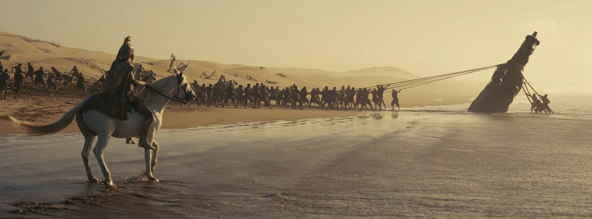
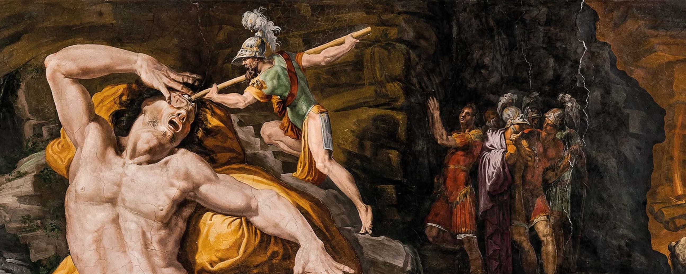
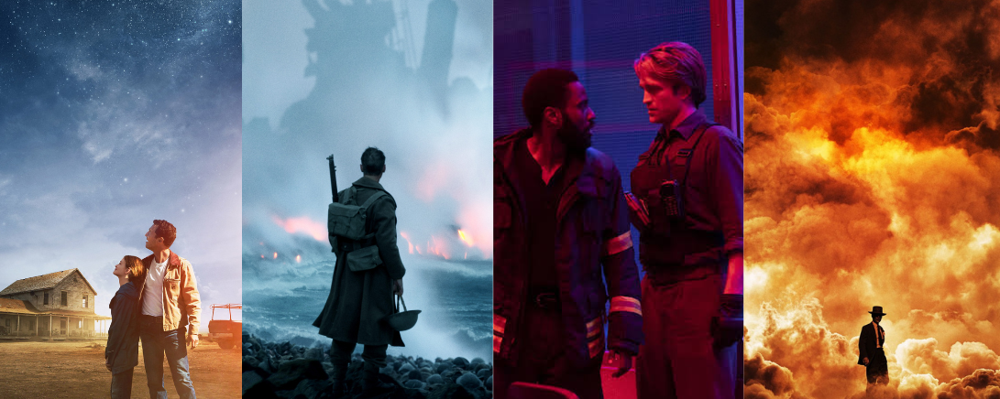

I watched Christopher Nolan’s Odyssey today in an IMAX theatre and enjoyed the drama. I loved the performance, the plot was tight-knit and the adventures kept coming one after another. Each one is a movie in itself, each bigger and some even more philosophical than the other. The movie paints Odysseus in a far more favourable light, with a redemption arc, finally getting to see Ithaca one last time before setting sail for his next adventure chasing the setting sun.

Matt Damon (would have been great if Christian Bale played Odysseus) gives a very worthy performance as the most cunning man in all of Greece, along with actors like Anne Hathaway, John Leguizamo, a cool looking Benny Safdie, Samantha Morton among others. Tom Holland and Robert Pattinson looked a little out of place to me, for I kept seeing “performances” in their performance. Zendaya does what she does best, show up for a brief moment and disappear until she appears an hour later.

The movie does a great job of keeping the gods at bay, even though the film starts with a title that sets the movie in a time of apparent magic. The magic is minimal, the CG is barely noticeable (except for a brief scene where the six-headed monster eats six of Odysseus’s crew) and the stakes are very human. This is a tale of a man cursed to live with the shame of his trickery, yearning to go back to his loved ones.

_Nolan drops the nobody scene from the original text, failing to capture Odysseus's cunning and hubris when he reveals his name, painting him as a hero_

Filmed for IMAX, the film pushes the limits of the technology. The movie has enough merit in the drama and adventure that the technology shouldn’t have been the gimmick to sell tickets. That said the movie also feels rather lacklustre, for the story that is often cited as the cornerstone epic of western literature falls short of the level of grandeur that I am used to in such tales.

When superhero movies were campy, flashy and light Nolan’s career defining Dark Knight trilogy put Nolan on the map for his gritty, realistic take on the superhero genre. He followed that with the story of a man and his promise to his daughter at the heart of an interstellar travel, the story of men and the effect of war on them, a James Bond stripped of his tools and allies and most recently that of the man who changed the world forever. All of these stories worked well within the Nolan world, with realism set in a plausible, practical world. This aesthetic did not feel out of place ever, these worlds worked well with the physics and economics that the Nolan works with.

_Nolan's last few outings at the movies did not defy physics at least_

This aesthetic has influenced a slew of directors, some emulating some trying to mimic the same. The DC universe was the worst hit. When Gunn took over DC, after years of a dark, tormented, aura farming Superman from the Snyder universe, to me the happy, more flawed Superman from James Gunn’s Superman, was a refreshing change. The very aesthetic that made Nolan’s career is what I least liked about the film. I am not looking for palaces with ornamental architecture or characters clad in gold but for a tale so epic the visuals while serving the purpose of the plot didn’t do much to convey the grandeur it deserves.

Take the Dune franchise, where the visuals create a sense of awe while staying as grounded as possible. Each scene carries a distinct character and personality that elevates it: the black sun of Giedi Prime, or the arrival of the Bene Gesserit in the first Dune, have striking visuals that etch the world deeper into the viewer's mind. This is where I think Odyssey falters the most, for its visuals feel commonplace, less epic.

Apart from Nolan’s visual choices, Odyssey might have also been limited by the medium of choice, IMAX cameras, unlike digital ones, are bulkier and louder, notoriously difficult to shoot, leading to times when the crew might have had to settle for less. The very two things that were used as the biggest marketing tool for the movie ended up at least to me what made its vision feel limited. Though a noble and never been done before feat, the very nature of Nolan’s filmmaking aesthetics and having to shoot the entire movie in IMAX made the film a little less of an epic.

Odysseus proclaims he’ll defy the gods if that’s what it takes to save his men, and fails. Nolan, defying the gods of cinema, has given us a film that is not quite epic but good nonetheless.
