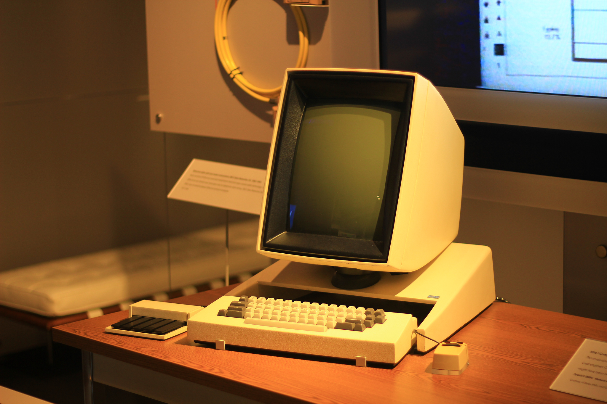
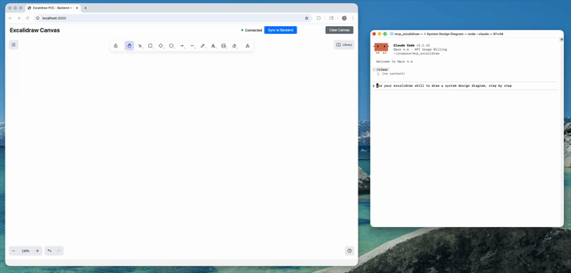
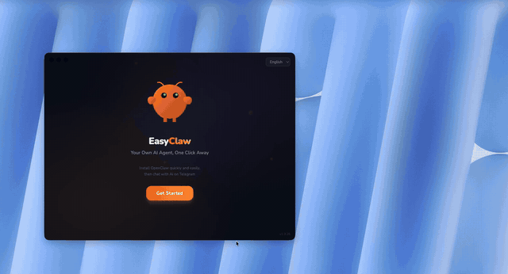

## From nerd machines to everyone's machine

When I think of an app, I imagine a neatly rendered user interface with buttons, images, accordions, layouts etc. We use apps with shiny features and great user experience every day. These shiny layouts, or Graphical User Interface (GUI), are what helped popularize the use of computer systems and various applications we use today as general-purpose electronics.

From [Douglas Engelbart](https://en.wikipedia.org/wiki/Douglas_Engelbart)'s [Augmentation of Human Intellect](https://en.wikipedia.org/wiki/Intelligence_amplification#Douglas_Engelbart:_Augmenting_Human_Intellect) in [SRI](https://www.sri.com/) which directly influenced the creation of [Alto](https://en.wikipedia.org/wiki/Xerox_Alto) personal computers from [Xerox PARC](https://en.wikipedia.org/wiki/PARC_(company)), to the [Apple Lisa](https://en.wikipedia.org/wiki/Apple_Lisa) and [Macintosh](https://en.wikipedia.org/wiki/Macintosh_128K) which revolutionized the way computers were perceived, we have moved from calling them specialist (nerd / hobbyist) machines to identifying these machines as user-friendly personal computers, in large part thanks to the user-friendliness the GUI brought in.

*Xerox Alto, widely considered the world's first true personal computer, pioneered the modern desktop experience with the first GUI, mouse, and windowed displays.*

The introduction of HTML, CSS and everything that came after cemented this, and further meant we could create more user-centric, user-friendly interfaces that helped popularize the use of computer systems and various applications we use today. Software development for general purpose consumers now required extensive research for best user experience, user interaction and a great deal of attention to frontend development than before. This is the experience that is researched, designed, developed and tested, providing a stable and most of the time a satisfying UX for all users in all scenarios.

## Text, again

But with the advent of AI, user interfaces have taken a complete 180 and have gone back into the days of text. We see more and more applications and software that ship with AI capabilities, most of which introduce chat services, a simple UI where the user can ask a question and get a reply back as text.

*Different models, different companies. The interface is always the same text box.*

Two years ago all we saw were text, mermaid diagrams and emojis trying to compensate for the lack of any color / pop within the response. Most new apps that boast about AI integration, irrespective of how fancy the feature, ultimately end up being a more stylized Command Line Interface. But with the arrival of MCP and MCP apps, in the last one year we are seeing a change in that as well. Excalidraw now has diagrams exposing MCP servers that the AI models can connect to with MCP clients and create better images, which the user can interact with, creating a collaborative interface for the user and the AI system.

*Using the Excalidraw MCP server, your agent can create, modify, and manipulate Excalidraw drawings via an API.*

## The super app problem

Things again changed when [OpenClaw](https://github.com/openclaw/openclaw) came out. We soon realized that all we need is just one super app that can talk to various other services and get things done for you instead of you having to click and navigate various screens and apps. Features once requiring a separate app are increasingly built directly into the super app. This is great for the user if they want to automate themselves away with multiple agents and subagents, but for a product this means something different.

*What used to take five apps and ten clicks, done in one prompt.*

One major crisis any product would face is the lack of discoverability. If your super app has some defaults that it understands or has better support, there is not much chance of your product ever reaching your intended audience. This will create a moat. Take for instance the surge in Next.js or Vite, TypeScript, Tailwind CSS, shadcn/ui, TanStack Query, and Zustand because of the training data dominance. Now this could become a similar stance for the general apps that we use.

If you don't have direct access to users, retention follows the same fate. The loops that keep users coming back are all built for users sitting in front of a screen. An agent has no screen. Notifications, streaks, personalized feeds make no impact on it. It completes the task and moves on.

And at the root of all of this, there is all the design investment. Years of research, wireframes, user testing and iterations are all in vain, for all of this was never designed with AI agents in mind. It calls the API, gets the data, and returns a result. The interface that took months to build is simply bypassed.

## Designing for the machine

The traditional user experience process had the user and their best possible experience as the only major goal, but in these changing times, AI might be our primary user. In such a world, is there a need for fancy UX, with cool animations & transitions? While for the same data, we can get more information with AI, why is it that we are not aiming for more in terms of experience? Another major concern is how much debugging and testing these traditional apps require, a tedious and cumbersome process in the AI world. Even basics like colors, themes and layouts can be a distraction for an AI agent crawling your website, for all of these are now tokens and for an AI model, more means less. The more you stuff into the context, the less value you would get out of it.

Take for instance accessibility. Traditional a11y relied on semantic tags, ARIA labels, and screen readers, a system designed for static interfaces that the user then has to adapt to. AI can revolutionize this.

Think of the possibilities of a fully AI-generated interface that renders itself based on a user's specific visual disability, adjusting contrast, layout, and density dynamically. Users can provide feedback, improve aspects of it, creating an interface custom-created for them. Such modern interfaces will have a11y as the default, and not a checklist item.

So on one hand you have mostly text-based interfaces, which are repetitive, less engaging and provide a mediocre user experience, while on the other hand is the super app, which simply makes the need for user experience design obsolete. Neither of these is wrong, but from a product development perspective what more can we do? As a user I don't want a chat interface on all the apps that I use, and I don't want to trust an agent to do whatever it wants, while I never get to see things for myself.

And just like any other designer / developer, all I am left with is the question: *For the systems of tomorrow, what is the right user experience?*
